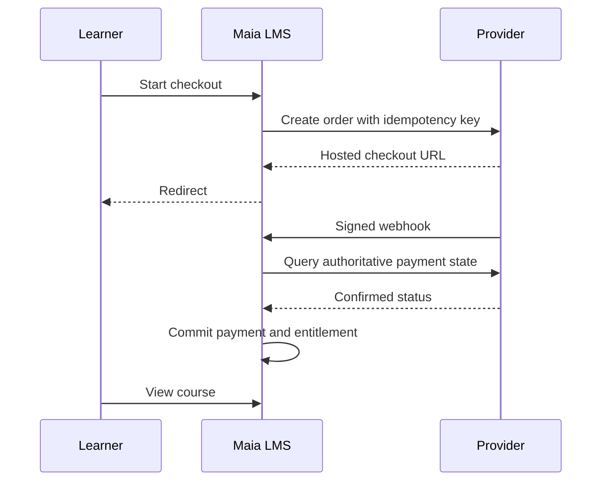

# Payments and entitlement

> **Initial MVP status:** this document records requirements for the complete product. The initial MVP delivered free text courses, identity, enrollment, and progress. Video, commerce, quizzes, certificates, MFA, and privacy requests still required implementation at that stage. See [the roadmap](09-roadmap.md) for subsequent deliveries.

## Initial implementation

Implement Mercado Pago hosted Checkout Pro first, with Pix availability verified for the merchant account and checkout configuration. Add PayPal through the same PaymentProvider contract after first release; PagBank/PagSeguro is a later adapter. Provider support, country, fees and settlement terms must be confirmed against the account before launch. Hosted checkout reduces payment-data exposure. Never process card numbers in Maia LMS.

## State machine

Order: CREATED → CHECKOUT_PENDING → PAID / EXPIRED / CANCELED; PAID → PARTIALLY_REFUNDED / REFUNDED / CHARGEBACK. Migration 035 enforces these transitions in SQLite, allows idempotent same-state writes, and permits a late authoritative confirmation to move EXPIRED/CANCELED to PAID. A late or repeated notification must still be reconciled against provider state; the trigger does not perform reconciliation. One course order captures immutable price, currency, account and promotion snapshot. Enrollment grant is based on confirmed provider capture/approved payment, not browser redirect, callback claims, or mere order approval.

Persist provider event ID and raw payload reference; verify webhook signature using provider-specific documented method and raw body, apply rate limits, then fetch authoritative state if required. Acknowledge fast and process idempotently. Reconciliation job checks pending and recently paid orders for missed webhooks and mismatches. Provider retries must not duplicate grants. Handle payment pending (especially Pix), expiry, duplicate checkout attempts, partial refunds, disputes and delayed reversals. Non-null provider checkout IDs are unique per provider; this database invariant does not validate how the provider creates or returns those identifiers. The database reserves pending plus approved refund amounts against the order snapshot and prevents the total from exceeding it; rejected refunds do not reserve the limit. Before enabling refunds, reconciliation must also verify the provider-captured amount. Alert on unprocessed events and paid-without-entitlement cases.

Use provider-required idempotency headers for create/refund with stable per-attempt keys; never regenerate the key for a network retry of the same operation. Keep secret keys server-side and rotate them. Separate sandbox and production credentials and webhook endpoints.

## Commerce policy to publish before charging

Display price/currency, taxes where applicable, scope and duration of access, refund/cancellation terms, support contact, company identity, privacy notice and certificate conditions. Implement locale-aware invoices/receipts according to accounting/legal advice; do not assume a payment receipt substitutes for a Brazilian nota fiscal. Obtain legal review of consumer rules and LGPD handling before launch.

## Official integration references (checked September 2026)

- Mercado Pago Checkout Pro orders: https://www.mercadopago.com.br/developers/en/docs/checkout-pro-orders/create-order
- Mercado Pago notifications and signature verification: https://www.mercadopago.com.br/developers/en/docs/checkout-pro-orders/notifications
- Mercado Pago Pix and idempotency: https://www.mercadopago.com.br/developers/pt/docs/checkout-api-orders/payment-integration/pix
- PayPal checkout webhooks: https://developer.paypal.com/payment-methods/webhooks/

Provider API details must be rechecked during implementation because integrations evolve.

## Local order and checkout flow — October 13, 2026

PAY-01 is implemented locally. Paid prices are part of immutable course revisions;
orders copy the published revision, title, terms, amount and currency, and checkout
creation is idempotent with pending-order reuse. The browser sends only course ID and
an idempotency key. A checkout return is informational; it never changes order state
or creates access. Development/test uses a local fake hosted-checkout screen to
exercise pending, canceled and approved states. Production checkout remains disabled
until the PAY-02 implementation is qualified against a Mercado Pago test account and
the configured webhook URL. No real payment provider or production checkout was used.

## Orders API adapter and webhooks — October 13, 2026

The Mercado Pago adapter now follows the current Checkout Pro Orders API contract:
`POST /v1/orders` with `type=online`, `processing_mode=manual`, exact item/total
amounts and a stable `X-Idempotency-Key`; authoritative state comes from
`GET /v1/orders/{order_id}`. Webhook verification uses the raw JSON body plus the
documented HMAC manifest built from `data.id` in the query, `x-request-id`, and `ts`
from `x-signature`. The handler verifies the body event/order IDs, fetches current
provider state, checks external reference/amount/currency, records unique event IDs
and payload hashes, and applies approved entitlement changes transactionally.
Duplicate event IDs with changed payloads are rejected. Full/partial refund and
chargeback state is now handled by PAY-04. Official references were checked October
13, 2026: [create order](https://www.mercadopago.com.br/developers/en/docs/checkout-pro-orders/create-order), [webhooks](https://www.mercadopago.com.br/developers/en/docs/checkout-pro-orders/notifications), [signature guidance](https://www.mercadopago.com.br/developers/en/docs/checkout-pro-orders/resources/notifications/webhooks), [refunds](https://www.mercadopago.com.br/developers/en/docs/checkout-api-orders/payment-management/refunds-cancellations), [chargeback notifications](https://www.mercadopago.com.br/developers/en/docs/checkout-api-orders/payment-management/chargebacks/notifications), and [order status](https://www.mercadopago.com.br/developers/en/docs/checkout-api-orders/payment-management/status/order-status). No live sandbox purchase, refund, or webhook delivery was run; production checkout remains disabled until operator sandbox qualification.

## Refunds, chargebacks, and order support

The admin-only `/api/v1/admin/orders` view supports buyer/course/order search,
status filters, order snapshots, approved/pending refund totals, receipt-email
delivery state, reasoned refunds, chargeback recording, and audit history. A partial
refund preserves order-backed access and active certificates. Once approved refunds
cover the full order snapshot, or an authoritative provider status reports a full
refund, the order access is revoked and active certificates are revoked with a
reason; enrollment/progress history remains. A chargeback (manual support record or
the signed `order.charged_back` notification) applies the same access/certificate
revocation policy and retains the provider case/status in the audit trail.

Refund reservations are created before the provider call. Retries retain the same
idempotency key and exact parameters; pending, rejected, approved, amount-mismatch,
and chargeback outcomes are visible in history. Provider `transactions.refunds`
entries are synchronized by provider refund ID, so later status changes update the
same local record. A partial provider refund does not revoke access; a full refund
does. Chargeback settlement is idempotent, and a stale approval cannot restore a
chargebacked/refunded order. The dashboard stores an unresolved browser retry in
session storage to preserve its idempotency key across reloads.

The receipt email outbox payload includes `orderId`, allowing admin support to show
queued/retrying/sent receipt state without parsing email text. Local automated tests
cover partial/full policy, certificate retention/revocation, pending-to-approved
retry, rejection, idempotency conflicts, provider refund reconciliation, signed
chargeback notifications, audit history, and receipt status. No real provider
credentials, sandbox transactions/refunds, or production deployment were used.

## Sandbox and production readiness

`MP_ENVIRONMENT` is explicit: nonproduction configuration must use `sandbox`, and
production configuration with the Mercado Pago provider must use `production`. The
token prefix is not used to infer mode; Mercado Pago documents that test-token
prefixes vary by integration and that Orders API test credentials may use `APP_USR`.
`PAYMENTS_CHECKOUT_ENABLED` accepts explicit `true`/`false` values, defaults to
`false`, and must be true with Mercado Pago credentials and seller ID before a real
provider checkout can be created. A disabled real-provider checkout is blocked in
all app environments; the local Fake provider remains available only outside
production. Refund handling for existing orders remains available independently of
new-checkout enablement.

This is configuration separation, not a completed launch review. Before real
activation, the owner and qualified accounting/legal party must confirm seller
identity, supported payment methods and currency, access/refund terms, customer
support details, receipt wording/invoice responsibilities, taxes, and consumer/LGPD
requirements. Sandbox purchase, refund, chargeback notification, and webhook
qualification still require the owner's test account and credentials. References:
[Mercado Pago credentials](https://www.mercadopago.com.br/developers/en/docs/checkout-api-orders/resources/credentials) and [test accounts](https://www.mercadopago.com.br/developers/en/docs/checkout-api-orders/resources/test-accounts).

## Confirmation and reconciliation — October 13, 2026

PAY-03 is complete locally. Signed order notifications and the buyer's **Refresh
payment status** action fetch the current Order from Mercado Pago and verify the
configured seller ID, local external reference, amount and currency before changing
access. Order/payment state, enrollment, entitlement and a localized confirmation
email outbox entry commit in one transaction. The worker checks aged pending orders
once per minute without blocking media or email jobs, and repairs PAID orders that
lack their enrollment/entitlement after a failed prior commit. Event/payment identity
and entitlement idempotency protect repeated or out-of-order notifications. Automated
tests use mocked Orders API responses and signed official-shaped events; no live
sandbox account, payment, webhook delivery, or production deployment was used.
Production checkout remains disabled until the owner completes sandbox and webhook
endpoint qualification. PAY-04 is complete locally; PAY-05 sandbox and operator
qualification remain outstanding.
